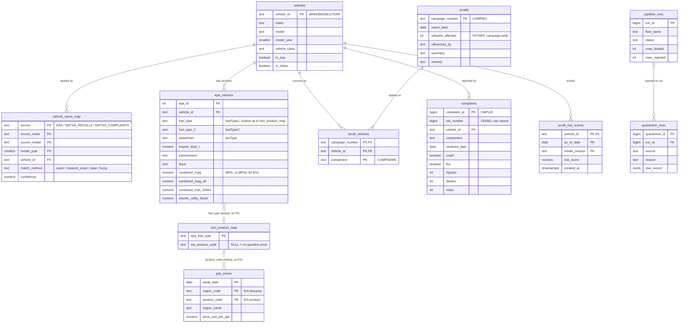

# AutoAtlas ERD (matches `sql/01_schema.sql` v0.3)

Solid lines are enforced foreign keys. Dotted lines are lookups the queries join on, with no FK constraint. GitHub renders this diagram automatically. To export a PNG for the report, paste the block into https://mermaid.live.

**Changes from the first-draft ERD:** `component` moved from `recalls` to `recall_vehicles`. `complaints` gained `odi_number`. The EPA fuel columns were added. Four tables are new: `gas_prices`, `fuel_product_map`, `pipeline_runs` and `quarantine_rows`. `recall_features` is still undecided (ML owner).
